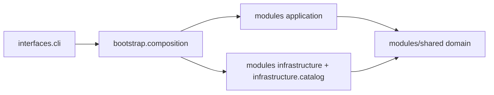

# 軟體架構

本專案採用單一部署單位的 Modular Monolith：依業務能力劃分模組，並在需要時於模組內區分 domain、application 與 infrastructure。目標是讓政策與用例不依賴 CLI、模型套件或檔案系統；目前仍是 Python 套件與命令列 PoC，不引入服務、資料庫或額外 runtime dependency。

## 套件結構

```text
clinical_warrant/
├── modules/
│   ├── classification/       # 分類公開 API；application、domain、infrastructure
│   ├── decision/             # warrant 決策公開 API；domain/application
│   └── evaluation/           # 評估公開 API；application、infrastructure
├── shared/domain/            # 共用資料契約與 catalog 型別/純驗證
├── infrastructure/           # JSON catalog loader、runtime metadata adapter
├── interfaces/cli.py         # argparse CLI adapter
├── bootstrap/composition.py  # 依賴與 adapters 的組裝位置
├── data/                     # prototypes、rules 與 mock cases
└── classifier.py、warrant.py、evaluation.py、catalog.py、contracts.py
                              # 舊匯入路徑的相容 facade
```

模組公開 API 從各模組的 `__init__.py` 匯出：分類位於 `clinical_warrant.modules.classification`，決策位於 `clinical_warrant.modules.decision`，評估位於 `clinical_warrant.modules.evaluation`。消費者應優先依賴這些入口，而不是模組內部的 application 或 infrastructure 路徑。

## 依賴方向



- Domain 保存政策、資料契約與純驗證，不依賴 CLI、模型、快取或檔案系統。
- 決策模組的 `domain/policy.py` 保存純決策政策；`application/warrant.py` 協調分類結果與規則資料並呼叫該政策。
- Application 協調分類、決策與評估用例；對外部 I/O 使用 ports/protocols，不直接載入模型或讀寫報告。
- Infrastructure 實作實際 I/O：分類模組負責模型 encoder 與 prototype cache，評估模組負責報告輸出，共用 `infrastructure/catalog.py` 透過 `importlib.resources` 載入 JSON。
- `bootstrap/composition.py` 是組裝點；`interfaces/cli.py` 解析命令並呼叫組裝後的應用程式。其他模組不應反向依賴 CLI 或 bootstrap。

各模組只建立實際需要的層，不為了目錄對稱新增空 package。跨模組互動透過公開 API 與共享 domain types；不要直接使用其他模組的 infrastructure 實作。

## 相容性

- 保留 `clinical-warrant` script、`python -m clinical_warrant`、`decide`/`evaluate` 命令，以及既有 JSON 欄位、決策值、reason codes、退出碼與輸出語意。
- 根 package 下原有 `classifier`、`warrant`、`evaluation`、`catalog`、`contracts` 路徑保留為薄 facade，轉送至新的模組 API。新程式碼使用上述模組公開 API；舊路徑維持既有呼叫相容。
- 套件仍採 `src` layout，`clinical_warrant.data` 的 JSON 需隨 wheel/sdist 打包；catalog loader 不依賴目前工作目錄。
- 這次調整只改程式內部邊界，不改 model ID/revision、prototype cache identity 或輸出格式。
