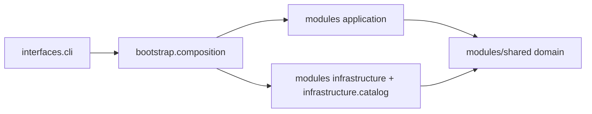

# 軟體架構

本專案採用單一部署單位的 Modular Monolith：依業務能力劃分模組，並在需要時於模組內區分 domain、application 與 infrastructure。目標是讓政策與用例不依賴 CLI、模型套件或檔案系統；目前仍是 Python 套件與命令列 PoC，不引入服務、資料庫或額外 runtime dependency。

## 套件結構

```text
clinical_warrant/
├── modules/
│   ├── classification/       # 分類公開 API；application、domain、infrastructure
│   ├── decision/             # warrant 決策公開 API；domain/application
│   └── evaluation/           # 評估公開 API；application、infrastructure
├── shared/domain/            # 共用資料契約與 catalog 型別/純驗證
├── infrastructure/           # JSON catalog loader、runtime metadata adapter
├── interfaces/cli.py         # argparse CLI adapter
├── bootstrap/composition.py  # 依賴與 adapters 的組裝位置
├── data/                     # prototypes、rules 與 mock cases
├── __init__.py               # 套件版本
└── __main__.py               # python -m clinical_warrant 入口
```

模組公開 API 從各模組的 `__init__.py` 匯出：分類位於 `clinical_warrant.modules.classification`，決策位於 `clinical_warrant.modules.decision`，評估位於 `clinical_warrant.modules.evaluation`。使用 `clinical_warrant.bootstrap.composition.build_warrant_engine()` 組裝 encoder、catalog、cache 與決策引擎；CLI script 與 `python -m clinical_warrant` 是命令列入口。消費者應依賴模組公開 API 或組裝入口，不直接依賴模組內部 infrastructure。

## 依賴方向



- Domain 保存政策、資料契約與純驗證，不依賴 CLI、模型、快取或檔案系統。
- 決策模組的 `domain/policy.py` 保存純決策政策；`application/warrant.py` 協調分類結果與規則資料並呼叫該政策。
- Application 協調分類、決策與評估用例；對外部 I/O 使用 ports/protocols，不直接載入模型或讀寫報告。
- Infrastructure 實作實際 I/O：分類模組負責模型 encoder 與 prototype cache，評估模組負責報告輸出，共用 `infrastructure/catalog.py` 透過 `importlib.resources` 載入 JSON。
- `bootstrap/composition.py` 是組裝點；`interfaces/cli.py` 解析命令並呼叫組裝後的應用程式。其他模組不應反向依賴 CLI 或 bootstrap。

各模組只建立實際需要的層，不為了目錄對稱新增空 package。跨模組互動透過公開 API 與共享 domain types；不要直接使用其他模組的 infrastructure 實作。

## Python imports 與外部介面

- 保留 `clinical-warrant` script、`python -m clinical_warrant`、`decide`/`evaluate` 命令，以及既有 JSON 欄位、決策值、reason codes、退出碼與輸出語意。
- 移除根 package 的六個舊模組 `clinical_warrant.catalog`、`classifier`、`cli`、`contracts`、`evaluation`、`warrant`。使用這些 Python imports 的程式需遷移至 `clinical_warrant.modules.classification`、`modules.decision`、`modules.evaluation`、`shared.domain`、`infrastructure.catalog` 或 `interfaces.cli`；建立正式應用時可從 `bootstrap.composition` 組裝。
- 套件仍採 `src` layout，`clinical_warrant.data` 的 JSON 需隨 wheel/sdist 打包；catalog loader 不依賴目前工作目錄。
- 這次調整只改程式內部邊界，不改 model ID/revision、prototype cache identity 或輸出格式。

## Context Intake 邊界（Commit 3 已完成分類路徑）

Context Intake 的 14 類 `category_id`、Category Registry 與 Sentence Transformer 分類路徑已實作；對話狀態、SQLite 儲存與 Coverage 尚未實作。分類器由 `build_intake_question_classifier(threshold=...)` 組裝，門檻須明確提供；它可注入既有 Sentence Transformer encoder，並使用獨立的 14 類 prototype catalog、分類結果型別及 `context-intake` 快取子目錄。既有四類 `QuestionType`、`build_warrant_engine()`、`decide` / `evaluate`、玩具規則與公開 JSON 契約不接收新類別，也不因 Category 欄位或 Coverage 改變決策。SQLite 由 intake infrastructure 使用 Python 標準庫 `sqlite3`，不讓 domain 依賴資料庫。

14 份 v2 Category JSON 已放在 `src/clinical_warrant/data/context_intake/categories/`，Registry loader 透過 `importlib.resources` 載入並驗證已登錄 ID。研究用 `prototypes.json`、`rules.json`、`mock_cases.json` 也已放入 `src/clinical_warrant/data/` 套件資源；14 類分類 prototypes 獨立位於 `src/clinical_warrant/data/context_intake/prototypes.json`，不取代 Category JSON 或研究 catalog。package-data 已設定包含上述 JSON；套件資源在目前工作樹可讀，但 wheel / sdist 安裝後的載入驗證尚未執行，因環境沒有可用的 Python。具體資料契約與分階段驗收見[功能規格](context-intake-spec.md)及[實作計畫](context-intake-implementation-plan.md)。
